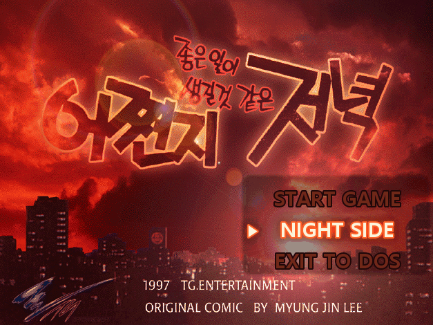
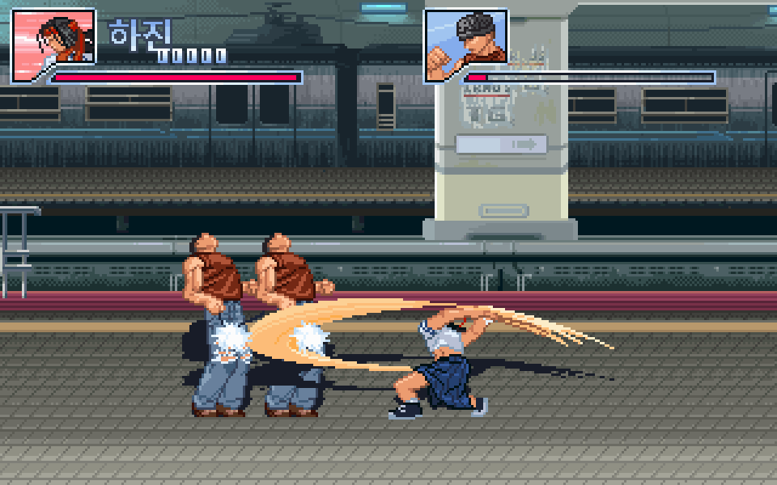
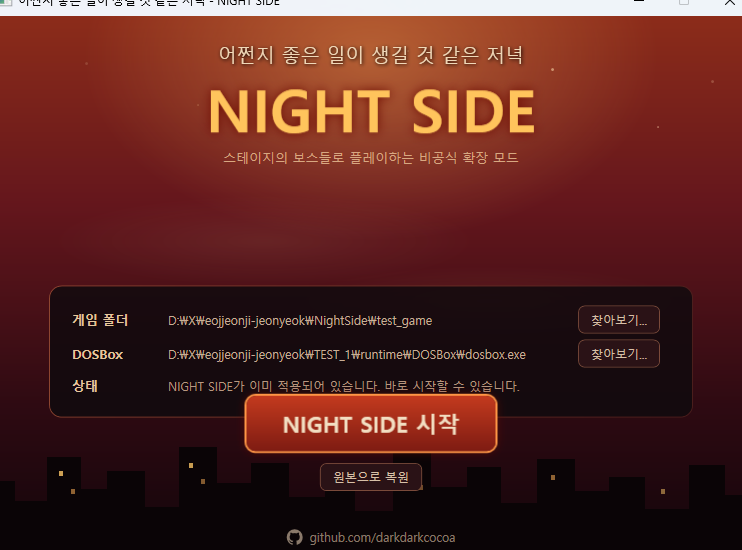

# 어쩐지 좋은 일이 생길 것 같은 저녁 — NIGHT SIDE

1997년 TG 엔터테인먼트의 DOS 격투 액션 게임
**「어쩐지 좋은 일이 생길 것 같은 저녁」**(원작: 이명진)에
스테이지 보스들을 플레이어블 캐릭터로 해금하는 비공식 확장 모드를 입히는
패치 런처입니다.



- 타이틀 메뉴에 **NIGHT SIDE** 항목 추가
- 캐릭터 셀렉트 화면 (2×4 그리드, 한글 명찰)
- 플레이어블 8인: 쏘가리 · 강은희 · 신의욱 · 민선웅 · 하진 · 문재웅 · 손서호 · 박종석
- 캐릭터별 공격 모션 지원, 원본 스토리 모드는 그대로 유지

## 스크린샷

| 캐릭터 셀렉트 | 인게임 플레이 |
|---|---|
|  |  |


## 요구 사항

| 항목 | 설명 |
|---|---|
| 원본 게임 파일 | `NIGHT.EXE` / `NIGHT.RES` (직접 소유한 정품 CD에서 설치) |
| DOSBox | [dosbox.com](https://www.dosbox.com/) 또는 호환 포크 |
| .NET 8 Desktop Runtime | 런처 실행에 필요 ([다운로드](https://dotnet.microsoft.com/download/dotnet/8.0)) |

**이 저장소에는 게임 데이터가 포함되어 있지 않습니다.**
패치 파일(`patches/*.sgbm`)은 원본 파일에 적용하는 바이너리 차분이며,
원본 게임 파일이 없으면 사용할 수 없습니다.

## 사용법



1. `NightSideLauncher.exe` 실행
2. **게임 폴더** — `NIGHT.EXE`가 있는 설치 폴더 선택
3. **DOSBox** — `dosbox.exe` 위치 선택 (자동 감지 지원)
4. **NIGHT SIDE 시작** 클릭
   - 원본 파일이면 패치를 적용하고 (`*.original`로 자동 백업) DOSBox로 게임을 실행합니다
   - 이미 패치된 파일이면 바로 실행합니다
5. 원본으로 되돌리려면 **원본으로 복원** 클릭

## 게임 조작 (NIGHT SIDE)

- 방향키: 이동 / CTRL·ALT·SPACE(또는 Z): 기본 기술
- SHIFT, SHIFT+ALT, SHIFT+CTRL: 캐릭터별 강기술
- 타이틀에서 NIGHT SIDE 진입 후 방향키로 캐릭터 선택, ENTER/SPACE 결정

## 폴더 구성

```
night-side/
├── NightSideLauncher.exe   런처 (WPF, .NET 8)
├── patches/                SGBM 바이너리 패치 + 해시 매니페스트
└── res/                    README 스크린샷
```

## 저작권 안내

「어쩐지 좋은 일이 생길 것 같은 저녁」의 모든 권리는 원저작권자인
**TG 엔터테인먼트**(TG Entertainment) 및 그 권리 승계인과,
원작 만화 **『어쩐지 좋은일이 생길것 같은 저녁』**의 **이명진 작가**에게 있습니다.

본 프로젝트는 순수한 팬심으로 제작된 비공식·비상업 패치이며,
게임 원본 데이터를 일절 포함하지 않습니다.
저작권자의 요청이 있을 경우 본 저장소와 배포물은 **예고 없이 삭제될 수 있습니다.**

## 크레딧

- 모드 제작: [github.com/darkdarkcocoa](https://github.com/darkdarkcocoa)
- 원작 게임: TG 엔터테인먼트 (1997) / 원작 만화: 이명진
- 본 모드는 팬 제작 비공식 패치이며 원저작권자와 무관합니다
