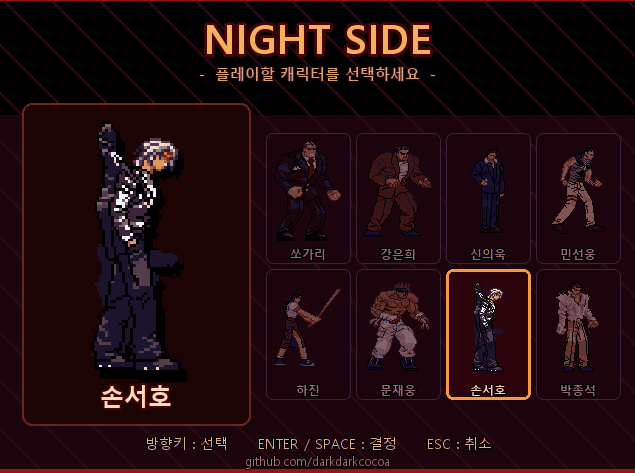
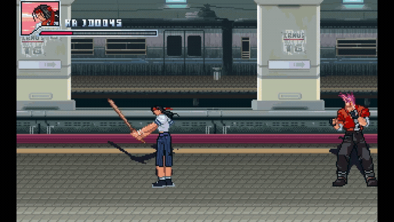
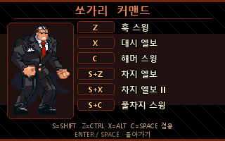

# 어쩐지 좋은 일이 생길 것 같은 저녁 — NIGHT SIDE

[](https://github.com/darkdarkcocoa/night-side/releases/latest)
[](https://github.com/darkdarkcocoa/night-side/releases)


1997년 TG 엔터테인먼트의 DOS 격투 액션 게임
**「어쩐지 좋은 일이 생길 것 같은 저녁」**(원작: 이명진)에
스테이지 보스들을 플레이어블 캐릭터로 해금하는 비공식 확장 모드를 입히는 패치입니다.


- 타이틀 메뉴에 **NIGHT SIDE** 항목 추가
- 캐릭터 셀렉트 화면 (2×4 그리드, 한글 명찰)
- 플레이어블 8인: 쏘가리 · 강은희 · 신의욱 · 민선웅 · 하진 · 문재웅 · 손서호 · 박종석
- 캐릭터별 고유 기술 6종 (약공격 3 + 강공격 3), 원본 스토리 모드는 그대로 유지
- HUD 한글 명찰, 인게임 커맨드표 (ESC → LEVEL UP MODE / COMMAND LIST)
- 새 버전 릴리스가 올라오면 런처가 알려주는 업데이트 알림

---

## ⚡ 빠른 시작 — 자동 패치 (추천)

가장 간단한 방법입니다. DOSBox 설정을 직접 관리하는 분들께 추천합니다.

1. [최신 릴리스](https://github.com/darkdarkcocoa/night-side/releases/latest)에서 **`NightSidePatch.exe`** 를 내려받습니다
2. `NIGHT.EXE` / `NIGHT.RES` 가 있는 **게임 설치 폴더에 넣고 더블클릭**합니다
3. 끝! 패치가 자동 적용됩니다 (원본은 `*.original` 로 자동 백업)
   - DOSBox로 `NIGHT.EXE` 실행 → 타이틀에서 **NIGHT SIDE** 선택
   - 같은 exe를 다시 실행하면 **원본 복원**(R 키)도 할 수 있습니다

> 원본 파일이 아니거나 이미 다른 패치가 적용된 파일이면 아무것도 건드리지 않고 종료합니다.

## 🚀 설치 방법 — 런처 (DOSBox 연동)

패치 적용부터 DOSBox 실행까지 한 번에 해주는 GUI 런처입니다.


1. [최신 릴리스](https://github.com/darkdarkcocoa/night-side/releases/latest)에서 **`NightSide-v○.○.○.zip`** 을 내려받아 압축 해제
2. `NightSideLauncher.exe` 실행 (`patches/` 폴더는 exe와 같은 위치에 둡니다)
3. **게임 폴더** — `NIGHT.EXE` 가 있는 설치 폴더 선택
4. **DOSBox** — `dosbox.exe` 위치 선택 (자동 감지 지원)
5. **NIGHT SIDE 시작** 클릭
   - 원본 파일이면 패치를 적용하고 (`*.original` 로 자동 백업) DOSBox로 게임을 실행합니다
   - 이미 패치된 파일이면 바로 실행합니다
6. 원본으로 되돌리려면 **원본으로 복원** 클릭

## 📋 요구 사항

| 항목 | 설명 |
|---|---|
| 원본 게임 파일 | `NIGHT.EXE` / `NIGHT.RES` (직접 소유한 정품 CD에서 설치, 1997년판) |
| DOSBox | [dosbox.com](https://www.dosbox.com/) 또는 호환 포크 |
| .NET 8 런타임 | 자동 패치는 Runtime, 런처는 Desktop Runtime 필요 ([다운로드](https://dotnet.microsoft.com/download/dotnet/8.0)) |

**이 저장소에는 게임 데이터가 포함되어 있지 않습니다.**
패치 파일(`patches/*.sgbm`)은 원본 파일에 적용하는 바이너리 차분이며,
원본 게임 파일이 없으면 사용할 수 없습니다.

## 🕹️ 게임 조작 (NIGHT SIDE)

- 방향키 : 이동
- **Z / X / C** : 기술 1 · 2 · 3 (원작 키 CTRL / ALT / SPACE 겸용)
- **SHIFT + Z / X / C** : 강기술 1 · 2 · 3 (SHIFT는 수식키 — 누른 채로 Z/X/C)
- ESC : 포즈 메뉴 — **LEVEL UP MODE / COMMAND LIST**를 열면 현재 캐릭터의 커맨드표가 뜹니다
- 타이틀에서 NIGHT SIDE 진입 후 방향키로 캐릭터 선택, ENTER/SPACE 결정

### 캐릭터별 기술

| 캐릭터 | Z | X | C | SHIFT+Z | SHIFT+X | SHIFT+C |
|---|---|---|---|---|---|---|
| 쏘가리 | 훅 스윙 | 대시 엘보 | 해머 스윙 | 차지 엘보 | 차지 엘보 II | 풀차지 스윙 |
| 강은희 | 원투 스매시 | 그라운드 브레이크 | 연속 펀치 | 퀵 스매시 | 대지진 찍기 | 점프 프레스 |
| 신의욱 | 크레센트 킥 | 스트레이트 | 콤보 러시 | 스텝 킥 | 차지 스트레이트 | 풀 크레센트 |
| 민선웅 | 퀵 잽 | 잽 러시 | 하이킥 | 카운터 블로 | 러시 콤보 | 콤보 킥 |
| 하진 | 퀵 스윙 | 풀 스윙 | 회전 베기 | 배트 러시 | 연속 스윙 | 더블 스핀 |
| 문재웅 | 보디 블로 | 보디 어퍼 | 엘보 러시 | 스핀 백핸드 | 더블 어퍼 | 돌진 태클 |
| 손서호 | 스트레이트 | 대시 펀치 | 사이드 킥 | 슬라이딩 킥 | 플라잉 킥 | 풀 콤보 |
| 박종석 | 스트레이트 | 연속 킥 | 카트휠 킥 | 더블 피스트 | 내려차기 | 브레이크 스핀 |

## 📸 스크린샷

**캐릭터 셀렉트**



**인게임 플레이**




**인게임 커맨드표** (ESC → LEVEL UP MODE / COMMAND LIST)



## 🔧 문제 해결

| 증상 | 해결 |
|---|---|
| Windows SmartScreen 경고 | 미서명 개인 빌드라 표시될 수 있습니다. "추가 정보 → 실행" 으로 진행하세요 |
| 실행하면 .NET 설치 안내가 뜸 | [.NET 8 런타임](https://dotnet.microsoft.com/download/dotnet/8.0)을 설치하세요 |
| "원본과 다릅니다" 오류 | CD/릴 차이, 번역판, 트레이너 등 해시가 다른 파일에는 적용되지 않습니다. `*.original` 백업이 있다면 먼저 복원하세요 |
| 캐릭터가 계속 점프함 | 원작의 알려진 증상 — **NUMLOCK 을 OFF** 로 두세요 |
| 원본으로 되돌리고 싶음 | 런처의 **원본으로 복원** 버튼, 또는 `NightSidePatch.exe` 재실행 후 R |

## 📁 폴더 구성

```
night-side/
├── NightSidePatch.exe      자동 패치 (게임 폴더에 넣고 더블클릭)
├── NightSideLauncher.exe   런처 (WPF, .NET 8 — 패치 + DOSBox 실행)
├── patches/                SGBM 바이너리 패치 + 해시 매니페스트
└── res/                    README 스크린샷
```

## 저작권 안내

「어쩐지 좋은 일이 생길 것 같은 저녁」의 모든 권리는 원저작권자인
**TG 엔터테인먼트**(TG Entertainment) 및 그 권리 승계인과,
원작 만화 **『어쩐지 좋은일이 생길것 같은 저녁』**의 **이명진 작가**에게 있습니다.

본 프로젝트는 순수한 팬심으로 제작된 비공식·비상업 패치이며,
게임 원본 데이터를 일절 포함하지 않습니다.
저작권자의 요청이 있을 경우 본 저장소와 배포물은 **예고 없이 삭제될 수 있습니다.**

## 크레딧

- 모드 제작: [github.com/darkdarkcocoa](https://github.com/darkdarkcocoa)
- 원작 게임: TG 엔터테인먼트 (1997) / 원작 만화: 이명진
- 본 모드는 팬 제작 비공식 패치이며 원저작권자와 무관합니다
